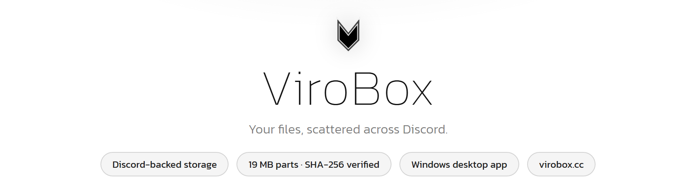
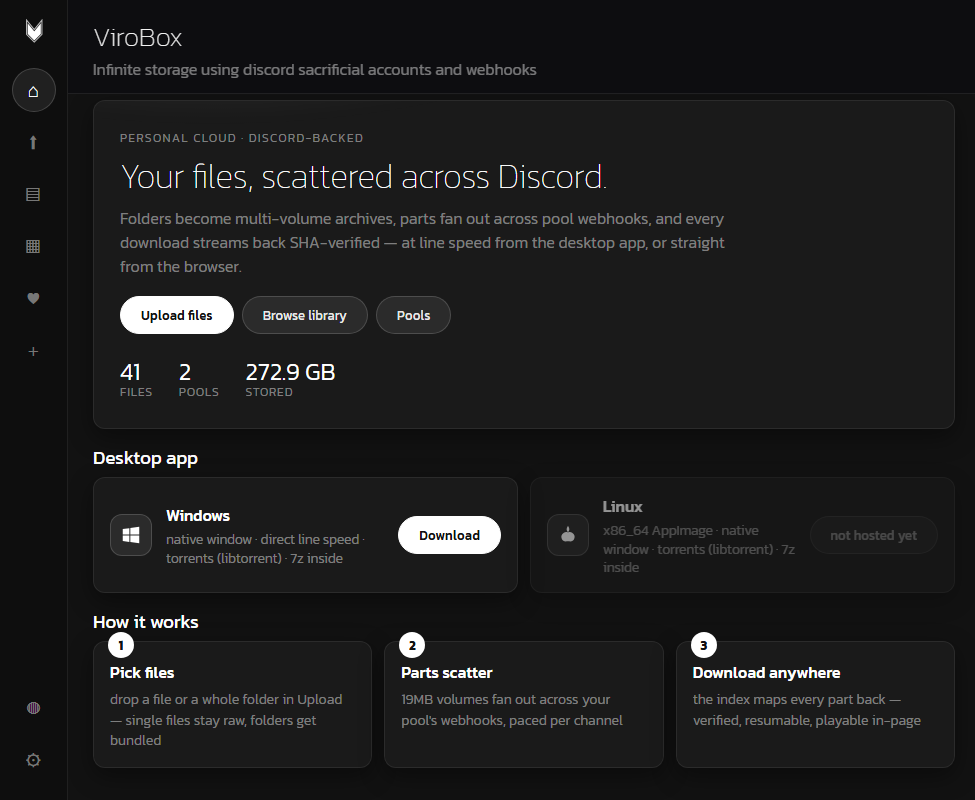
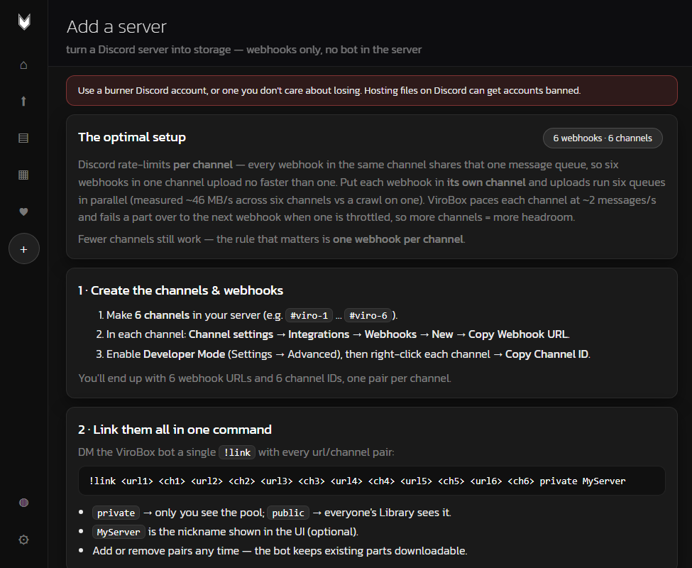
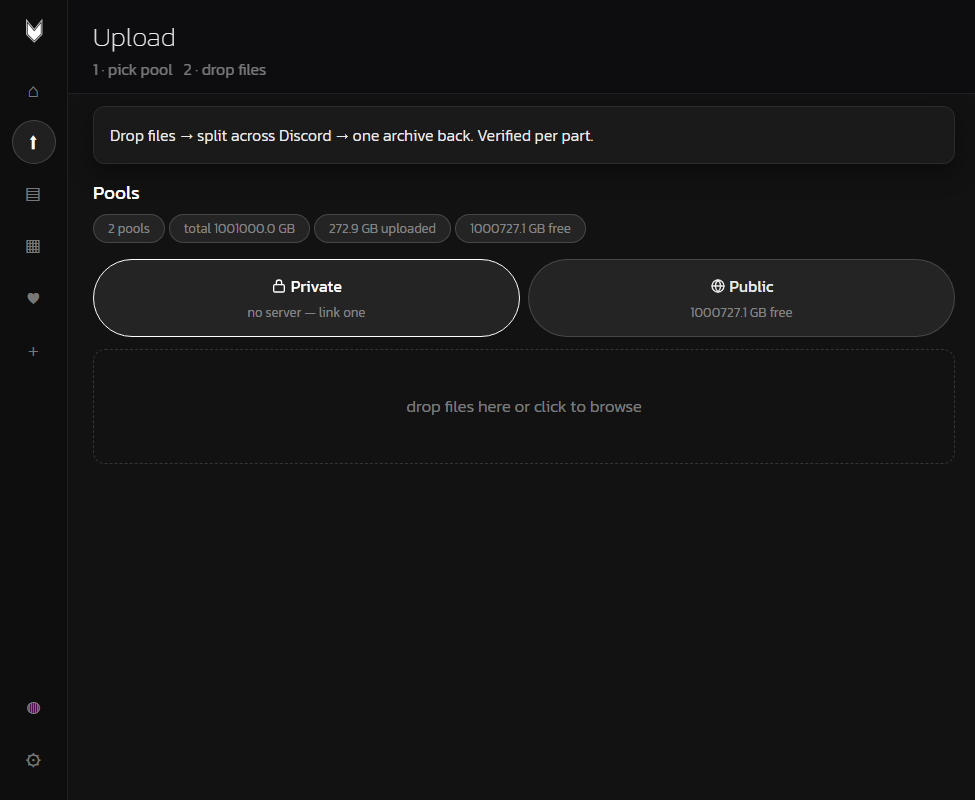

<picture>
  <source media="(prefers-color-scheme: dark)" srcset="assets/hero.png">
  <source media="(prefers-color-scheme: light)" srcset="assets/hero-light.png">
  
</picture>

**ViroBox** is free personal storage backed by Discord webhooks — uploads are
split into ~19 MB parts, scattered across a pool of webhook channels, indexed,
and streamed back verified.

[virobox.cc](https://virobox.cc) · [Discord](https://discord.gg/6Dp792s53D) · [Releases](https://github.com/Saperan/virobox/releases)

## Screenshots

Home — upload, browse and pools, with live counters:

Add a server — your own Discord server becomes the storage:

Upload — drop files, pick the pool:

## What it is

ViroBox turns a set of Discord webhooks into personal file storage. The
server keeps only the index; the bytes live in Discord channels you control.

- **Split & scatter** — files are chunked across multiple webhooks/channels
  (Discord rate-limits per channel, so pools use several).
- **Verified downloads** — every part's SHA-256 is checked as it streams
  back; CDN URLs are re-resolved per download, so links never go stale.
- **Share cards** — `/f/<token>` links unfurl in Discord/OG clients with
  the file name, size, uploader and pool.
- **Playback** — common media plays in the browser (native seeks, subtitle
  and audio-track support); oversized/exotic files get a download card.

## Free quotas

- 100 GB public / 50 GB private per account (per-pool overrides exist).

## Desktop app

Fast direct transfers (PC → Discord, no phone relay): a Windows exe,
downloadable from the site. The same source builds a Linux AppImage
(native window, tray stub, flock single-instance). The app handles uploads,
downloads, torrents and browser-download handoff.

## FAQ

Full version at https://virobox.cc/faq.

## Good to know

- ViroBox is a hosted service — **not open source and not self-hostable**.
- Files live on Discord's CDN through webhooks; treat it as a personal
  gray-area backup tool, use a burner Discord account, keep your own copy of
  anything important.
- Not end-to-end encrypted storage.
- Content reports are handled via the in-app Report button and the Terms
  at https://virobox.cc/faq.

## License

All rights reserved. The source is not public. This repository is the
project's showcase and release channel.

## Contact

https://virobox.cc · Discord: https://discord.gg/6Dp792s53D
